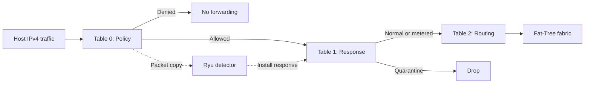

# SDN Microsegmentation and Adaptive Threat Response

A Python networking lab exploring explicit access policies and behaviour-based responses in a software-defined network.

**Stack:** Python · Ryu · OpenFlow 1.3 · Open vSwitch · Mininet · Linux

## Background and my contribution

This portfolio version is based on a university group project run in a Linux virtual machine using UTM. My main contribution was **dynamic-window detection and tiered response**: tracking destination diversity, adjusting detection parameters using per-host strikes, and escalating from temporary throttling to quarantine. I also presented this part of the project and designed the group project website.

**[View the group project website](https://sites.google.com/view/2026t2ztrust-mini-project)**

Topology, routing and policy components provide the wider group-project context; I do not claim independent authorship of every component. This portfolio edition adds documentation and regression checks and corrects source-host filtering in the verification script.

## Architecture

The k=4 Fat-Tree contains **16 hosts and 20 switches**: 8 edge, 8 aggregation and 4 core switches. Four pods represent Core Services, Operations / Media, Guest Wi-Fi and IoT Devices. These are simulated roles, not physical wireless or IoT equipment.



Policy precedes response, preventing a throttle rule from granting access denied by the ACL. Aggregation and core switches handle transit routing.

## Access policy

| Source | Destination | Policy |
|---|---|---|
| Any host | Same pod | IPv4 allowed |
| Operations, pod 1 | Core Web, `10.0.0.2:80` | TCP allowed |
| IoT, pod 3 | Management, `10.0.0.3:8000` | TCP allowed |
| Designated servers | Respective client pods | TCP source-port return rules |
| Other cross-pod traffic | Other pods | Denied and observed |

## Dynamic detection

| Prior strikes | Window | Distinct destinations | Next response |
|---|---:|---:|---|
| 0 | 10 s | 5 | Tier 1: configured 128 kbps meter |
| 1 | 8 s | 4 | Tier 2: quarantine |
| 2 | 6 s | 3 | Tier 2: quarantine |
| 3+ | 4 s | 2 | Tier 2: quarantine |

Responses expire after 10 seconds. Reputation resets on the next observation more than 20 seconds after the last strike. These are demonstration settings, not production-tuned thresholds. A shorter window and lower threshold do not guarantee better detection for all traffic patterns.

Designated service/monitoring IPs are exempt from detection but retain their normal ACL permissions. See [design trade-offs and limitations](docs/design.md).

## Running the lab

Use the original Linux VM with working **Mininet, Open vSwitch and Ryu**. Native macOS cannot run this Mininet datapath. Exact VM versions have not yet been recorded; these commands assume the existing working environment rather than a verified clean installation.

From this repository directory, start two terminals:

```bash
# Terminal 1
ryu-manager --ofp-tcp-listen-port 6633 fattree_routing.py

# Terminal 2
sudo python3 fattree_topo.py
```

Run one suite in the Mininet CLI:

```python
py __import__('fattree_traffic').run_traffic_demo(net)
```

Or, in a fresh controller/network session:

```python
py __import__('verify_dynamic_window').verify_complete_demo(net)
```

Restart both Ryu and the topology between suites so earlier strikes do not affect results. Exit Mininet with `exit`. Inspect enforcement using:

```text
mininet> sh ovs-ofctl -O OpenFlow13 dump-flows e_2_0 table=1
mininet> sh ovs-ofctl -O OpenFlow13 dump-meters e_2_0
mininet> sh ovs-ofctl -O OpenFlow13 meter-stats e_2_0
```

## Validation

The original group project was run and validated in a Linux VM hosted in UTM. The scripts cover six traffic scenarios and five adaptive-response checks.

For the portfolio edition, six offline regression tests passed. The source-host filtering correction in the verification script has not been rerun against the live Mininet network; this does not replace or invalidate the original project validation. See the [validation guide](docs/validation.md) for the distinction and optional reproduction steps.

Run dependency-free regression checks with:

```bash
python3 -m unittest discover -s tests -v
```

These check controller parameter logic and verification parsing, not the real OpenFlow datapath. No measured latency, throughput or detection-accuracy benchmark is claimed.

## Files

| File | Purpose |
|---|---|
| `fattree_topo.py` | Topology, static ARP, services and Mininet CLI |
| `fattree_routing.py` | Routing, ACLs, detection and enforcement |
| `fattree_traffic.py` | Six-scenario demonstration |
| `verify_dynamic_window.py` | Escalation, isolation, exemption and recovery |
| `tests/test_regressions.py` | Offline regression checks |
| `docs/design.md` | Decisions and limitations |
| `docs/validation.md` | Repeatable validation and evidence |

This is a **Zero Trust-inspired microsegmentation lab**, not a complete Zero Trust architecture: authenticated identities, device posture and encrypted service identity are outside its scope.
